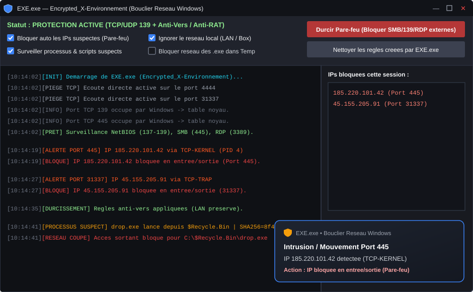

<div align="center">

# 🛡️ EXE.exe
### Bouclier réseau & détection d'intrusion pour Windows

**Version 1.5** · Surveillance réseau · Honeypots TCP/UDP · Réponse via le Pare-feu Windows

[](https://github.com/teremuhamblin/EXE.exe/actions/workflows/ci.yml)
[](https://github.com/teremuhamblin/EXE.exe/actions/workflows/codeql.yml)
[](https://github.com/teremuhamblin/EXE.exe/releases)
[](LICENSE)
[](#prérequis)

[⬇️ Téléchargement](https://github.com/teremuhamblin/EXE.exe/releases/latest) · [⚡ Compilation](#-compiler-depuis-les-sources) · [🧩 Fonctionnalités](#-fonctionnalités) · [🔐 Limites et sécurité](#-limites-et-sécurité) · [🤝 Contribution](#-contribuer)

<br>




</div>

---

## ✨ Présentation

**EXE.exe** est un outil de surveillance réseau et de détection d'intrusion pour **Windows 10 et 11**. Inspiré du concept historique d'**AntiNuke.exe** (1997), il associe surveillance des connexions, pièges réseau et actions de filtrage par le Pare-feu Windows.

> **En bref :** observer l'activité réseau, signaler les comportements ciblés et appliquer des règles de blocage selon la configuration de l'outil.

---

## 🧩 Fonctionnalités

| Module | Ce qu'il fait |
| :--- | :--- |
| 🕸️ **Honeypots TCP/UDP** | Écoute les ports sensibles disponibles et signale les connexions reçues. |
| 🔎 **Inspection des connexions** | S'appuie sur `iphlpapi.dll` pour consulter les connexions TCP actives et les PID associés. |
| 🧱 **Règles Pare-feu Windows** | Peut créer des règles de blocage pour les adresses IP suspectes à l'aide des outils du pare-feu Windows. |
| 🔒 **Durcissement réseau** | Propose le filtrage entrant de services et ports couramment ciblés, notamment NetBIOS, SMB, RPC, RDP et Telnet. |
| 🧪 **Surveillance de processus** | Repère les exécutables lancés depuis certains emplacements sensibles, calcule leur empreinte SHA-256 et applique les actions réseau prévues par l'application. |
| 🔔 **Zone de notification Windows** | Fonctionne en arrière-plan et affiche des alertes lors d'événements détectés. |

---

## 🎯 Ports et protocoles ciblés

<details>
<summary><b>Afficher la matrice des ports configurés</b></summary>

| Ports | Protocoles | Services ou menaces associés |
| :--- | :--- | :--- |
| `137`, `138`, `139` | TCP / UDP | NetBIOS, WinNuke et propagation réseau |
| `445` | TCP | SMB, EternalBlue, WannaCry, NotPetya |
| `135` | TCP | RPC/DCOM et mouvements latéraux |
| `3389` | TCP / UDP | RDP et tentatives de prise de contrôle |
| `21`, `23`, `69`, `1433`, `5900` | TCP / UDP | FTP, Telnet, TFTP, SQL Server et VNC |
| `4444`, `5555`, `6666`, `6667`, `8081` | TCP | Shells distants, botnets IRC et RAT |
| `11223`, `12345`, `27374`, `31337` | TCP / UDP | Ports associés à d'anciens chevaux de Troie, dont NetBus, Sub7 et Back Orifice |

> La disponibilité et la surveillance effective d'un port dépendent des sockets déjà utilisés, des règles Windows et de la configuration locale. La présence d'un port dans cette liste ne signifie pas qu'un logiciel malveillant y est actif.

</details>

---

## ⚡ Compiler depuis les sources

Le projet fournit un script de compilation Windows. Selon l'installation de Windows et les composants disponibles, le compilateur C# (`csc.exe`) peut être nécessaire.

```bat
git clone https://github.com/teremuhamblin/EXE.exe.git
cd EXE.exe
build.bat
```

Le script génère `EXE.exe` à la racine du dépôt.

### Prérequis

- Windows 10 ou 11 ;
- les composants de compilation requis par `build.bat` ;
- des droits administrateur pour les opérations qui modifient le Pare-feu Windows ou nécessitent l'accès aux ports concernés.

> Examinez le script de compilation et le code source avant d'exécuter un binaire ou d'accorder des privilèges élevés.

---

## 🔐 Limites et sécurité

EXE.exe est un outil complémentaire de surveillance réseau. **Il ne remplace pas** Microsoft Defender, un antivirus, un pare-feu correctement configuré ni une solution de détection et réponse aux incidents.

- Les honeypots ne peuvent écouter que les ports disponibles et accessibles selon la configuration du système.
- Les règles de pare-feu peuvent affecter la connectivité ou des applications légitimes ; vérifiez-les avant et après toute modification.
- Une détection peut produire des faux positifs. Examinez le contexte et les journaux avant de bloquer ou de supprimer une règle.
- L'observation des connexions locales ne garantit pas la détection de toutes les menaces.
- Utilisez les droits administrateur uniquement lorsque l'action demandée les exige.
- Téléchargez le projet depuis ce dépôt et vérifiez les changements avant de l'utiliser sur une machine importante.

> [!CAUTION]
> Les modifications de règles du Pare-feu Windows ont un impact sur le trafic réseau. Testez dans un environnement maîtrisé et conservez un moyen de restaurer votre configuration.

---

## 🛠️ Dépannage

- **La compilation échoue :** vérifiez les prérequis mentionnés par `build.bat` et les messages affichés dans la console.
- **Un port ne peut pas être écouté :** il peut déjà être utilisé, réservé ou filtré par Windows ou un autre logiciel.
- **Une action du pare-feu échoue :** vérifiez les droits, l'état du service Pare-feu Windows et les règles existantes.
- **Une application perd sa connectivité :** inspectez les règles créées par EXE.exe et retirez uniquement celles dont vous avez confirmé l'origine et l'effet.

---

## 🤝 Contribuer

Les contributions et signalements sont les bienvenus. Pour contribuer :

1. Forkez le dépôt et créez une branche dédiée ;
2. décrivez clairement le problème ou l'amélioration ;
3. testez les changements dans un environnement Windows adapté ;
4. ouvrez une Pull Request avec les étapes de vérification.

### Ressources du projet

- [📘 Guide de contribution](.github/CONTRIBUTING.md)
- [📜 Code de conduite](.github/CODE_OF_CONDUCT.md)
- [🚨 Signaler une vulnérabilité](.github/SECURITY.md)
- [👥 Mainteneurs](.github/MAINTAINERS.md)
- [📝 Historique des versions](.github/VERSION.md)
- [⚖️ Licence MIT](LICENSE)

---

## 📊 Projet

[](https://github.com/teremuhamblin/EXE.exe/commits)
[](https://github.com/teremuhamblin/EXE.exe/stargazers)
[](https://github.com/teremuhamblin/EXE.exe/issues)

<div align="center">

**Fait avec 🛡️ pour une défense réseau plus claire et accessible.**

</div>
