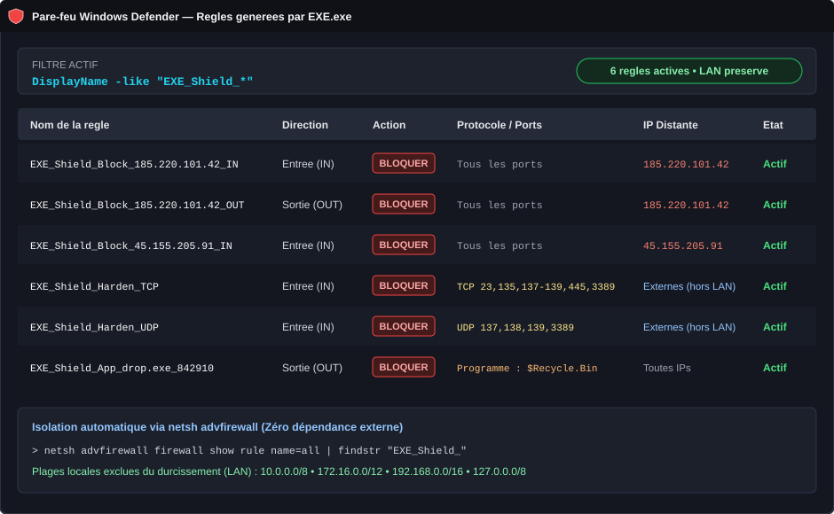
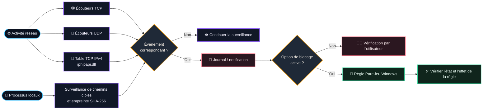
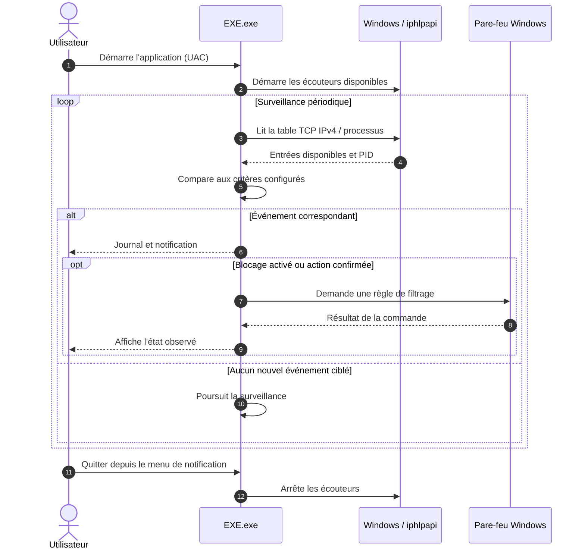

<div align="center">

# 🛡️ EXE.exe
### Bouclier réseau & détection locale pour Windows

**Version 1.5 Stable** · Surveillance TCP/UDP · Analyse des connexions · Actions Pare-feu Windows

[](https://github.com/teremuhamblin/EXE.exe/actions/workflows/ci.yml)
[](https://github.com/teremuhamblin/EXE.exe/actions/workflows/codeql.yml)
[](https://github.com/teremuhamblin/EXE.exe/releases)
[](LICENSE)
[](#-configuration-requise)

[⬇️ Releases](https://github.com/teremuhamblin/EXE.exe/releases) · [⚙️ Compilation](#-compiler-depuis-les-sources) · [🧩 Fonctionnalités](#-capacités) · [🗺️ Architecture](#️-architecture-de-détection) · [🔐 Sécurité](#-sécurité-et-limites) · [🤝 Contribution](#-contribuer)

<br>




<br>

<sub>Inspiré par le concept historique d'AntiNuke.exe (1997) — repensé comme un outil local de visibilité et de réponse réseau.</sub>

</div>

---

## ✨ Présentation

**EXE.exe** est une application Windows de surveillance réseau et d'interaction avec le Pare-feu Windows. Elle combine des écouteurs TCP/UDP sur des ports configurés, la consultation de la table des connexions TCP IPv4 via `iphlpapi.dll`, une surveillance basique de certains processus et des actions de filtrage configurables dans l'interface.

> **À retenir :** une alerte est un indicateur à examiner, pas une preuve qu'une activité est malveillante. La liste de ports est une heuristique et ne constitue pas une signature antivirus.

### 🧭 Repères rapides

| Repère | Détail |
| :--- | :--- |
| 🖥️ **Plateforme** | Windows 10 / Windows 11 |
| 🧰 **Technologie** | C# · Windows Forms · .NET Framework / `csc.exe` |
| 🌐 **Visibilité réseau** | Honeypots TCP/UDP disponibles + table TCP IPv4 Windows |
| 🧱 **Réponse** | Règles du Pare-feu Windows selon les options et actions utilisées |
| 🔑 **Élévation** | Le manifeste demande les droits administrateur au démarrage |
| 📜 **Licence** | MIT — voir [`LICENSE`](LICENSE) |

---

## 🧩 Capacités

| Module | Fonctionnement | À savoir |
| :--- | :--- | :--- |
| 🕸️ **Honeypots TCP/UDP** | Tente d'écouter sur une liste de ports et signale les datagrammes ou connexions reçus. | Un port déjà utilisé ou inaccessible ne peut pas être écouté par l'application. |
| 🔎 **Table des connexions TCP** | Consulte périodiquement les connexions TCP IPv4 via `GetExtendedTcpTable` et récupère le PID associé lorsqu'il est disponible. | La surveillance de connexions n'est pas une analyse complète du trafic et ne couvre pas tous les protocoles. |
| 🧱 **Blocage d'adresse IP** | Peut créer des règles entrantes et sortantes dans le Pare-feu Windows pour une adresse détectée. | Un blocage automatique peut perturber une connexion légitime ; vérifiez les règles et les alertes. |
| 🛡️ **Durcissement entrant** | Le bouton de durcissement crée des règles de filtrage pour certains ports réseau ciblés. | L'action modifie le pare-feu système. Confirmez son impact avant de l'appliquer. |
| 🧪 **Surveillance de processus** | Signale certains exécutables repérés dans `%TEMP%`, `Users\Public` et `$Recycle.Bin`, avec calcul d'une empreinte SHA-256. | L'emplacement seul ne permet pas de conclure qu'un fichier est malveillant. Le blocage dépend des options et du chemin détecté. |
| 🔔 **Zone de notification** | Affiche l'état et des alertes depuis l'interface et la zone de notification Windows. | L'application peut rester active après fermeture de la fenêtre ; utilisez « Quitter » pour l'arrêter. |

---

## 🗺️ Architecture de détection

Le schéma représente les grandes étapes de l'application. Les actions de blocage dépendent de la configuration, des droits disponibles et du résultat des commandes système.



### 🧾 Légende du diagramme

| Style | Signification |
| :--- | :--- |
| 🔵 **Bleu** | Source d'événement : activité réseau ou processus local |
| 🟣 **Violet** | Collecte et observation effectuées par l'application |
| 🟠 **Ambre** | Décision ou condition de traitement |
| 🌸 **Rose** | Notification ou vérification humaine |
| 🟢 **Vert** | Action système ou contrôle après action |

### 🔄 Cycle de surveillance



> **Lecture :** une commande envoyée au pare-feu n'est pas, à elle seule, une garantie que le trafic est correctement filtré. Vérifiez le résultat dans Windows et testez l'accès réseau attendu.

---

## 🎯 Ports et protocoles ciblés

La liste ci-dessous reflète les ports configurés dans le code. Les ports TCP et UDP ne sont pas tous identiques : consultez les colonnes pour le périmètre exact.

<details>
<summary><b>📡 Afficher la matrice des ports configurés</b></summary>

| Groupe | TCP | UDP | Contexte indicatif |
| :--- | :--- | :--- | :--- |
| 🧩 **Services Windows / réseau** | `21`, `23`, `135`, `139`, `445`, `1433`, `3389`, `5900` | `69`, `137`, `138`, `139`, `161`, `1900` | FTP, Telnet, RPC/DCOM, NetBIOS, SMB, SQL Server, RDP, VNC, TFTP, SNMP, SSDP |
| 🛰️ **Ports supplémentaires** | `4444`, `5555`, `6666`, `6667`, `8081`, `11223`, `12345`, `27374`, `31337` | `11223`, `31337` | Ports souvent utilisés dans des environnements de test ou associés à divers outils et logiciels |

**Légende :** `TCP` et `UDP` désignent les protocoles de transport. Les noms de services et associations sont indicatifs ; un port donné peut servir à une application légitime.

> ⚠️ Un port listé n'est pas nécessairement ouvert, écouté ou accessible depuis Internet. Windows, un autre logiciel, le profil réseau, le routeur et le pare-feu influencent la disponibilité et la visibilité.

</details>

---

## ⚡ Compiler depuis les sources

### Configuration requise

- Windows 10 ou Windows 11 ;
- le compilateur C# du .NET Framework 4.x (`csc.exe`) dans l'un des emplacements recherchés par `build.bat` ;
- des droits administrateur pour lancer l'application, comme demandé par `src/app.manifest`.

### Étapes

```bat
git clone https://github.com/teremuhamblin/EXE.exe.git
cd EXE.exe
build.bat
```

Le script compile les sources de `src/` et produit `EXE.exe` à la racine du dépôt. Si la compilation échoue, consultez le message affiché et vérifiez que le compilateur requis est installé.

> 🔍 **Avant de lancer le binaire :** examinez le code source et le script de compilation. L'application demande une élévation administrateur et peut modifier les règles du pare-feu.

### 📥 Télécharger une version publiée

Consultez la page [Releases](https://github.com/teremuhamblin/EXE.exe/releases). Si un checksum SHA-256 est fourni, comparez-le au fichier téléchargé avant exécution. Le badge de release indique la dernière version publiée sur GitHub ; le libellé de version de cette documentation n'est pas une preuve de publication.

---

## 🔐 Sécurité et limites

> [!IMPORTANT]
> EXE.exe est un outil complémentaire de visibilité réseau. Il **ne remplace pas** Microsoft Defender, un antivirus, un pare-feu correctement configuré ou une solution EDR.

### 🧯 À garder en tête

- **Détection ≠ verdict :** une connexion ou un processus situé dans un dossier sensible peut être légitime. Vérifiez le contexte avant toute action.
- **Pas de couverture exhaustive :** les écouteurs sont limités aux ports disponibles et la table consultée concerne les connexions TCP IPv4. L'application n'analyse pas chaque paquet réseau.
- **Risque de faux positifs :** les ports configurés sont des indicateurs génériques, pas des signatures fiables de malware.
- **Impact du pare-feu :** les règles de blocage peuvent couper l'accès à des services ou applications légitimes. Conservez une méthode de récupération et contrôlez les règles ajoutées.
- **Privilèges élevés :** n'exécutez qu'un binaire obtenu depuis une source de confiance après examen des sources, des changements et du checksum disponible.
- **Test prudent :** commencez dans une machine virtuelle ou un environnement de test, notamment avant d'utiliser l'action de durcissement.

> [!CAUTION]
> Une erreur de configuration du pare-feu peut interrompre des connexions réseau. Vérifiez les règles créées par EXE.exe et leur portée avant de les conserver ou de les supprimer.

### 🛡️ Signaler une vulnérabilité

Ne publiez pas de vulnérabilité non corrigée dans une Issue publique. Suivez la [politique de sécurité](.github/SECURITY.md) pour contacter le mainteneur de manière responsable.

---

## 🛠️ Dépannage

| Symptôme | Vérifications utiles |
| :--- | :--- |
| ❌ `csc.exe` introuvable | Vérifiez l'installation du compilateur .NET Framework 4.x et les chemins recherchés par `build.bat`. |
| 🚫 Un piège ne démarre pas | Le port peut être déjà utilisé, réservé ou inaccessible. L'application ne peut écouter que sur un port disponible. |
| 🧱 Une règle n'apparaît pas ou échoue | Vérifiez l'élévation, le service Pare-feu Windows, le profil réseau et les éventuelles erreurs de commande. |
| 🌐 Une application perd l'accès réseau | Inspectez les règles EXE.exe dans le Pare-feu Windows et identifiez leur portée avant toute modification. |
| 🔔 L'application semble toujours active après fermeture | Elle peut être réduite dans la zone de notification ; choisissez **Quitter** dans son menu pour arrêter la surveillance. |

---

## 🤝 Contribuer

Les contributions sont les bienvenues. Pour faciliter leur revue :

1. Ouvrez une Issue pour décrire le problème ou proposer une amélioration ;
2. créez une branche dédiée à votre changement ;
3. testez les modifications sur Windows, en particulier celles qui affectent le pare-feu ;
4. ouvrez une Pull Request avec le comportement attendu, les tests effectués et les limites connues.

### 📚 Documents du projet

- [📘 Guide de contribution](.github/CONTRIBUTING.md)
- [📜 Code de conduite](.github/CODE_OF_CONDUCT.md)
- [🚨 Politique de sécurité](.github/SECURITY.md)
- [👥 Mainteneurs](.github/MAINTAINERS.md)
- [📝 Historique des versions](.github/VERSION.md)
- [🗺️ Feuille de route](ROADMAP.md)
- [⚖️ Licence MIT](LICENSE)

---

## 📊 État du dépôt

[](https://github.com/teremuhamblin/EXE.exe/commits)
[](https://github.com/teremuhamblin/EXE.exe/stargazers)
[](https://github.com/teremuhamblin/EXE.exe/issues)

<div align="center">

### 🛡️ Observer. Comprendre. Agir avec prudence.

**Fait avec soin pour une sécurité réseau plus lisible, transparente et open-source.**

[⬆️ Retour en haut](#️-exeexe)

</div>
